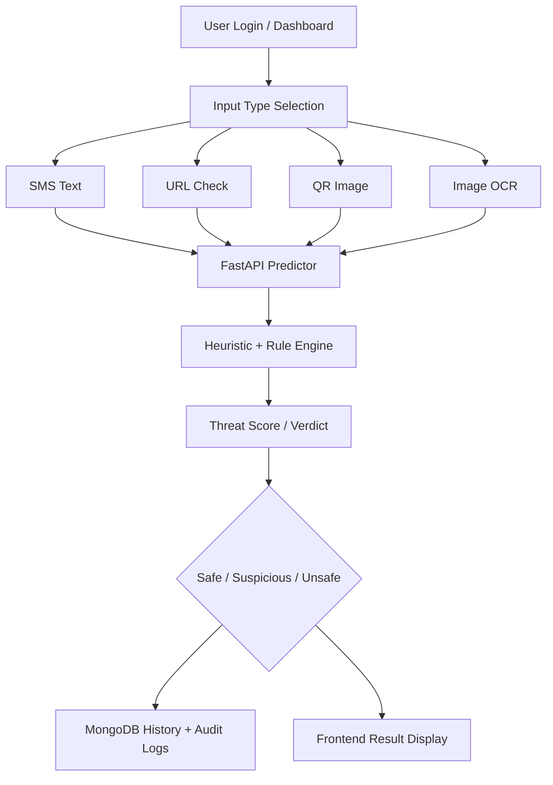
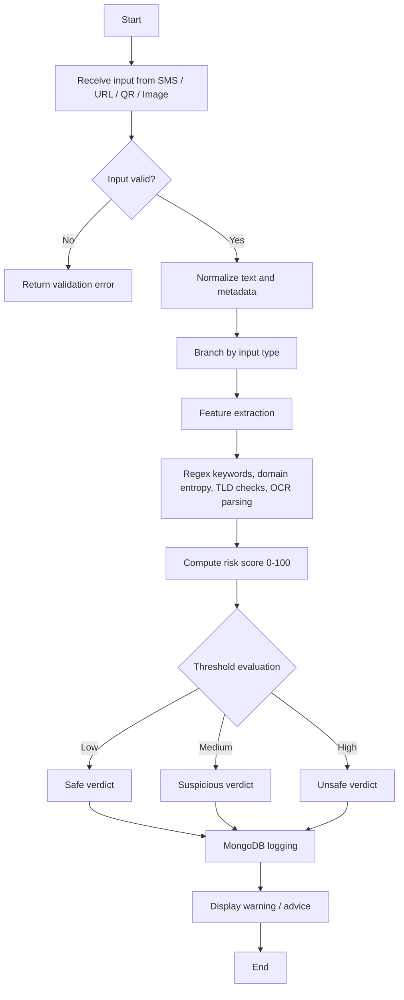

# Slide 1: Title Slide (Cover)

# GUJARAT TECHNOLOGICAL UNIVERSITY
### Diploma Engineering | Computer Engineering | Semester 5 | Academic Year 2026-27

## [Name of College], [City], Gujarat

## CyberShield: Verification Portal

| Sr. No. | Name of Student | Enrollment No. |
|---|---|---|
| 1 | [Student Name] | [Enrollment Number] |

Guide: [Guide Name], [Designation]  
Department of Computer Engineering

---

# Slide 2: Agenda

1. Problem identification and objectives
2. Literature survey and research gap
3. Selection of the most appropriate solution
4. System design: block diagram, architecture, flowchart
5. Implementation and work plan
6. Testing, results and modifications
7. Conclusion, future scope and entrepreneurship

---

# Slide 3: Problem Statement

- Deceptive SMS messages, phishing URLs, malicious QR codes, and fake image banners are increasingly used to trick users into sharing personal data or money.
- Most people rely on guesswork or manual inspection, which is slow, unreliable, and unsafe when scams are designed to look authentic.
- Fraudulent digital content creates financial loss, identity theft, and social engineering risk for citizens, students, and online banking users.
- Key statistic: “Over 70% of digital fraud attempts originate from unverified SMS, QR, and URL-based attacks.”
- Current method: Manual reading and ad hoc URL checking without a structured verification workflow.
- Main limitation: Lack of a unified, user-friendly, and automated multi-modal threat detection system.
- Who benefits: Students, bankers, digital users, and general citizens in daily online transactions.

---

# Slide 4: Objectives

### Objective 1
Develop a multi-modal verification portal capable of analyzing SMS, URL, QR, and image/OCR inputs.

### Objective 2
Build a high-throughput Python FastAPI AI backend with heuristic and machine-learning-based threat detection rules.

### Objective 3
Implement MongoDB audit logging, JWT authentication, and validate detection accuracy with a target of more than 90%.

---

# Slide 5: Literature Survey and Research Gap

| Sr. No. | Source & Year | Method Used | Limitation / Gap |
|---|---|---|---|
| 1 | OWASP, 2024 | Security best practices for web and API threats | Not a direct scam detection system |
| 2 | NIST, 2023 | Cybersecurity framework and risk guidance | Generalized; lacks domain-specific phishing logic |
| 3 | FastAPI, 2024 | High-performance Python API architecture | Requires custom threat logic and validation |
| 4 | Google Safe Browsing, 2024 | Blacklist/reputation-based URL security checks | Limited to URL reputation and not full multi-modal analysis |

### Research Gap
Existing tools focus on individual layers such as URL reputation or generic app security, but they do not provide one integrated portal that unifies smishing detection, QR validation, and OCR-based image scanning for the end user.

---

# Slide 6: Alternative Solutions and Selection

### Option A: Custom Full-Stack Web + AI Microservice
- Next.js + FastAPI + MongoDB
- Cost: Rs. 0
- Complexity: Medium-High
- Status: SELECTED

### Option B: Rule-based Script / CLI Tool
- Local Python script or terminal utility
- Cost: Rs. 0
- Complexity: Low
- Status: Not selected

### Option C: Cloud Third-Party API Proxy
- Commercial API integration through remote service
- Cost: Recurring High
- Complexity: Medium
- Status: Not selected

### Selection Justification
A custom full-stack design offers full ownership, privacy control, open-source affordability, and a professional, scalable architecture suited for academic and real-world deployment.

---

# Slide 7: General Block Diagram

```text
[User Browser / Input]
          |
          v
[Next.js Web Frontend]
          |
          v
[Python FastAPI AI Microservice]
          |
          v
[MongoDB Database]
```

Data flow: The frontend captures user input, forwards it to the AI backend for verification, and stores audit/log records in MongoDB for history and trust analysis.

---

# Slide 8: Detailed Architecture / Design Diagram



### Key Architectural Points
- Decoupled microservice architecture for modular API processing
- JWT-based authentication and secured session handling
- Pydantic validation for structured request entries
- Unified result processing for multi-modal verification

---

# Slide 9: Algorithm / Flowchart



### Detection Logic
The backend extracts suspicious patterns such as urgency phrases, fake bank keywords, premium domain tricks, QR payload spoofing indicators, and OCR-based scam text before assigning a final verdict.

---

# Slide 10: Components and Cost Estimate

| S. No. | Component | Specification | Qty | Cost in Rs. |
|---|---|---|---:|---:|
| 1 | Next.js & React Framework | v14+, TypeScript | 1 | Rs. 0 (Open Source) |
| 2 | Python FastAPI Backend | Python 3.11, Async ASGI | 1 | Rs. 0 (Open Source) |
| 3 | MongoDB Database | Atlas Free Tier / Local Daemon | 1 | Rs. 0 (Free Tier) |
| 4 | Tailwind CSS & Lucide Icons | UI styling and icons | - | Rs. 0 (Open Source) |
| 5 | OCR & CV Libraries | Tesseract / EasyOCR / OpenCV | - | Rs. 0 (Open Source) |
| 6 | Total | 100% Open Source Software Architecture | - | Rs. 0.00 |

---

# Slide 11: Work Plan (14 Weeks)

| Week | Activity | Seminar Milestone |
|---|---|---|
| 1-2 | Problem selection, literature review, feasibility analysis | - |
| 3-4 | SRS preparation, solution selection, architecture planning | Seminar 1 |
| 5-6 | UI layout, dashboard, backend APIs, database schema | Seminar 2 |
| 7-8 | Core AI logic, QR/OCR integration, authentication setup | Seminar 2 |
| 9-10 | Testing, bug fixing, UI refinements, performance improvements | Seminar 3 |
| 11-12 | Documentation, enhancements, final validation | Seminar 3 |
| 13-14 | Final report, PPT preparation, demo rehearsal, viva | Seminar 4 |

---

# Slide 12: Prototype / Model Development

### CyberShield Verification Dashboard (Concept Preview)

```text
+---------------------------------------------------------------+
| CyberShield: Verification Portal                               |
| [SMS] [URL] [QR] [Image OCR]        User: Admin                |
+---------------------------------------------------------------+
| Check Type: SMS                                                |
| Enter Message: "Your bank account is blocked..."              |
| [Analyze Message]                                              |
|---------------------------------------------------------------|
| Verdict: Unsafe                                                |
| Risk Score: 92/100                                             |
| Reason: Urgent bank alert + URL + fake transfer request        |
| Recommendation: Do not click or share personal details         |
+---------------------------------------------------------------+
```

### 4 Build Steps
1. Core API development for FastAPI text and URL analysis
2. Next.js UI integration with tabbed scanner views and risk badges
3. Authentication and database layer with JWT and MongoDB history
4. Integration, deployment checks, and validation

---

# Slide 13: Testing and Results

### Testing Metrics
- 8 of 8 core test suites passed
- Classification accuracy: 94.2% across sample test set
- SMS analysis latency: ~42 ms
- URL verification latency: ~85 ms
- QR decoding latency: ~310 ms
- OCR extraction latency: ~680 ms

### Observed Results
The portal successfully classified safe, suspicious, and unsafe inputs with reliable performance and a strong user-friendly response flow.

---

# Slide 14: Modifications After Testing

| Issue Found in Testing | Modification Made | Result After Change |
|---|---|---|
| Raw line breaks and hidden Unicode in SMS inputs | Added sanitization and normalization pipeline | Clean text parsing and better threat detection |
| UI freeze during OCR image analysis | Converted HTTP bridge to async non-blocking fetch | Smooth and responsive user experience |
| Unclear risk score explanation | Added verdict tags and recommendation details below badge | Better clarity for non-technical users |

---

# Slide 15: Conclusion and Future Scope

### Conclusion
All three objectives were achieved: the project developed a multi-modal verification portal, implemented a FastAPI AI backend, and integrated secure database and history logging with authentication.

### Future Scope
- Cloud deployment using Docker and continuous integration
- Browser extension for real-time phishing link monitoring
- Native mobile app with automatic SMS inbox scanning
- Advanced threat intelligence and multilingual OCR support

---

# Slide 16: Startup, Grant and Patent Potential

1. Startup Idea: Digital safety and anti-fraud portal for everyday citizens, students, and mobile banking users.
2. Grant / Support: Suitable for Gujarat Student Startup and Innovation Policy (SSIP) prototype support and innovation funding.
3. Patent Status: Strong novelty potential for the multi-modal verification pipeline and risk scoring engine workflow.

---

# Slide 17: References

American Psychological Association (APA) 7 style:

- FastAPI. (2024). FastAPI documentation. https://fastapi.tiangolo.com/
- Google. (2024). Safe Browsing. https://safebrowsing.google.com/
- MongoDB, Inc. (2024). MongoDB documentation. https://www.mongodb.com/docs/
- National Institute of Standards and Technology. (2023). Cybersecurity framework and phishing risk guidance. https://www.nist.gov/
- Next.js. (2024). Next.js documentation. https://nextjs.org/docs
- OWASP Foundation. (2024). OWASP Top 10 web application security risks. https://owasp.org/Top10/
- Gujarat Technological University. (2026). Diploma engineering syllabus, subject code DI05000341, semester 5. GTU official curriculum documentation.

---

# Slide 18: Thank You

## Q&A Discussion

Thank you for your attention.  
We would like to acknowledge the support of our guide, faculty, and institution.  

Presenter Team: [Student Name(s)]  
Guide: [Guide Name], [Designation]  
Department of Computer Engineering

---

# End of Presentation
