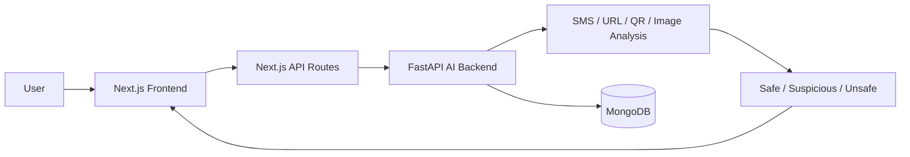
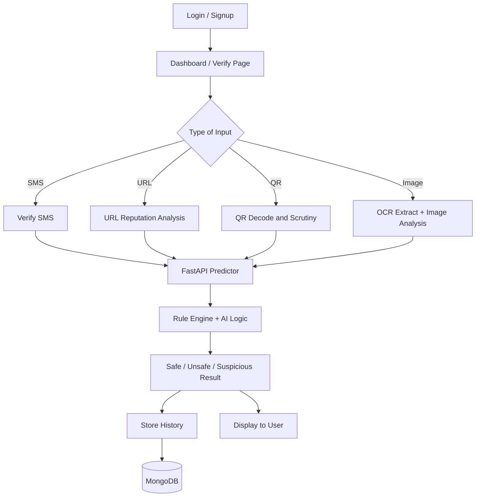
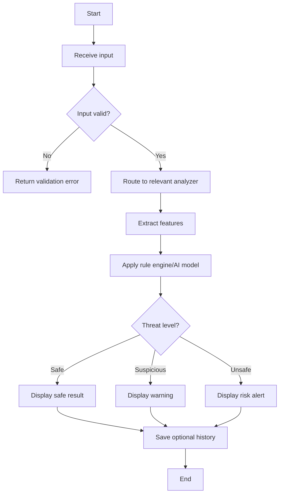

# CyberShield: Verification Portal

## GTU Diploma Minor Project Report

### Administrative Details
- University: Gujarat Technological University (GTU)
- Program: Diploma in Computer Engineering
- College: [College Name]
- Subject Code: DI05000341
- Semester: 5
- Academic Year: 2026-27
- Project Title: CyberShield: Verification Portal
- Student Name: [Student Name]
- Enrollment No.: [Enrollment Number]
- Student Email: [Student Email]
- Guide Name: [Guide Name]
- Guide Designation: [Guide Designation]
- Department: Computer Engineering
- Submission Date: [Date]

---

## Certificate

This is to certify that Mr./Ms. [Student Name], Enrollment No. [Enrollment No.], of Diploma in Computer Engineering, Semester V, [College Name], has successfully completed the minor project entitled “CyberShield: Verification Portal” under the guidance of [Guide Name] for the subject code DI05000341 during the academic year 2026-27.

This project is a bonafide work carried out by the student and has been found satisfactory in all respects.

Signature of Guide: ____________________  
Name of Guide: [Guide Name]  

Signature of Head of Department: ____________________  
Name: [HOD Name]  

Signature of Principal: ____________________  
Name: [Principal Name]  

---

## Acknowledgement

I would like to express my sincere gratitude to my project guide, [Guide Name], for his/her valuable guidance, constructive suggestions, and continuous support throughout the project work. I am also thankful to the faculty members of the Computer Engineering Department for encouraging and motivating me to pursue this project with dedication.

I am grateful to [College Name] for providing the necessary infrastructure and learning environment. I also thank my classmates and family for their support and encouragement. This project would not have been possible without their cooperation and confidence in my work.

---

## Abstract

The rapid growth of digital communication has increased the risk of phishing, scam SMS messages, malicious URLs, fake QR codes, and fraudulent image-based content. Many users, especially those unfamiliar with online cyber threats, fail to distinguish between authentic and deceptive information. This project presents CyberShield: Verification Portal, an AI-powered web-based system that helps users verify suspicious digital content before trusting it.

The system integrates a Next.js frontend with a Python FastAPI AI backend to analyze SMS text, URLs, QR codes, and uploaded images. It uses rule-based logic, heuristic checks, and AI-driven threat inference to classify content as Safe, Unsafe, or Suspicious. The system also stores verification history in MongoDB and supports user authentication, feedback submission, and report generation for reviewing previous checks.

The portal is designed for real-world use in digital safety awareness, online banking security, and educational demonstration projects. It provides a simple user interface for non-technical users while maintaining a scalable backend architecture. The project demonstrates practical application of web development, artificial intelligence, cybersecurity concepts, and database integration in a single functional system.

---

## Table of Contents

[To be filled by student as per final formatting]

---

## List of Figures

1. Figure 1: General block diagram of the CyberShield system  
2. Figure 2: Detailed architecture and verification workflow  
3. Figure 3: Algorithm and flowchart for scam detection  
4. Figure 4: Prototype screenshot/dashboard placeholder  
5. Figure 5: Test performance graph or screenshot placeholder  

---

## List of Tables

1. Table 1: Literature review summary and research gap  
2. Table 2: Alternative solution comparison  
3. Table 3: Components and estimated cost  
4. Table 4: Work plan / seminar schedule  
5. Table 5: Test results and observations  

---

## List of Abbreviations

- AI – Artificial Intelligence  
- API – Application Programming Interface  
- DB – Database  
- GTU – Gujarat Technological University  
- HTTP – Hyper Text Transfer Protocol  
- JWT – JSON Web Token  
- ML – Machine Learning  
- MVP – Minimum Viable Product  
- OCR – Optical Character Recognition  
- QR – Quick Response  
- REST – Representational State Transfer  
- SSIP – Student Startup and Innovation Policy  
- UI – User Interface  
- UX – User Experience  
- URL – Uniform Resource Locator  
- UPI – Unified Payment Interface  
- VS Code – Visual Studio Code  
- WAF – Web Application Firewall (conceptual/monitoring layer)  

---

# Chapter 1: Introduction

## 1.1 Background

Modern society depends heavily on mobile communication, digital banking, e-commerce, and online information sharing. However, this growth has also introduced an increase in cybercrime activities such as phishing scams, fake SMS alerts, suspicious URLs, and malicious QR codes. Attackers often use trusted-looking messages to manipulate user behavior, steal personal credentials, and deceive users into transferring money.

This is especially relevant in the context of computer engineering education, where students are expected to apply software engineering, database management, web systems, and intelligent data processing to solve real-world societal problems. CyberShield aims to address this issue by creating a digital safety platform capable of verifying risky content before users respond to it.

The project combines a web-based interface with backend AI services to detect suspicious messages and malicious links. It demonstrates how modern full-stack web development, machine learning principles, and cybersecurity awareness can be combined into a practical product for everyday users.

## 1.2 Problem Identification and Statement

Users frequently receive SMS messages, URLs, or QR codes that appear legitimate but are designed to steal data, mislead customers, or perform fraud. A common issue is that most users do not have the technical knowledge or tools to determine whether a message or link is trustworthy. This creates serious risks including financial loss, account compromise, identity theft, and privacy violations.

There is therefore a need for an accessible, efficient, and automated verification system that can warn users before they click, scan, or trust suspicious content. CyberShield addresses this need by providing a platform that verifies SMS content, URLs, QR codes, and image-based messages in a simple user interface.

## 1.3 Objectives

1. To design and develop a web-based verification portal that detects phishing and scam-like content from SMS, URL, QR, and image inputs.  
2. To implement an intelligent backend using Python-based AI and rule-engine logic for analysis and classification.  
3. To test the system with sample inputs and evaluate its accuracy, usability, and practical effectiveness for real-world scenarios.  

## 1.4 Scope and Type of Project

The project is a software-based application and prototype system developed in the area of cyber security and digital fraud detection. It falls under the category of practical engineering system development with user interface, backend integration, data handling, and intelligent analysis.

The scope includes:
- SMS scam checking
- URL trust analysis
- QR code validation
- Image/OCR analysis
- User authentication and profile management
- Verification history log
- Feedback collection

This project is closely aligned with the curriculum by integrating concepts from web engineering, database systems, networking, security, and intelligent application design.

## 1.5 Organisation of the Report

This report is divided into eight chapters. Chapter 1 introduces the project, its background, problem statement, scope, and objectives. Chapter 2 reviews existing literature and technologies related to scam detection. Chapter 3 discusses alternative solutions and justification for the selected system. Chapter 4 explains the system design and architecture. Chapter 5 covers implementation and work planning. Chapter 6 focuses on testing, results, and improvements. Chapter 7 presents conclusion and future scope, and Chapter 8 discusses entrepreneurship, grant, and patent potential. The appendices include code excerpts and implementation-related material from the workspace.

---

# Chapter 2: Literature Review

## 2.1 Survey of Existing Systems

A review of current technologies and related literature shows that phishing detection and fraud prevention systems widely use rule-based filtering, text analysis, URL reputation checking, and machine learning classification.

1. OWASP Foundation. (2024). OWASP Top 10 web application security risks. https://owasp.org/Top10/  
2. National Institute of Standards and Technology (NIST). (2023). Cybersecurity framework and phishing risk guidance. https://www.nist.gov/  
3. FastAPI. (2024). FastAPI documentation. https://fastapi.tiangolo.com/  
4. Vercel. (2024). Next.js documentation. https://nextjs.org/docs  
5. MongoDB. (2024). MongoDB documentation. https://www.mongodb.com/docs/  
6. Google Safe Browsing / URL reputation concepts. (2024). Safe browsing and threat intelligence practices. https://safebrowsing.google.com/  

These sources provide the foundation for security architecture, API development, web application security, and threat classification mechanisms used in the project.

## 2.2 Summary of Literature and Research Gap

| Table 1: Summary of Literature Review |  |  |  |
|---|---|---|---|
| Author / Source | Method / Approach | Key Finding | Limitation |
| OWASP Foundation | Security best practices | Highlights common web vulnerabilities and attack patterns | Not a direct scam detector |
| NIST | Cybersecurity standards | Offers security framework for risk mitigation | Generic; not domain-specific |
| FastAPI | API framework | Provides fast backend architecture | Requires custom threat logic |
| Next.js | Frontend framework | Enables responsive and modern UI | Not security-specific |
| MongoDB | Database platform | Stores user and history records reliably | Requires schema design and indexing |
| Google Safe Browsing / URL reputation models | Threat intelligence | Useful for phishing and malicious URL detection | Limited to public reputation checks |

The literature shows that while sources exist for secure development and detection principles, there is a lack of a single, beginner-friendly, integrated system that combines SMS verification, URL analysis, QR scanning, OCR-based image detection, and user-facing portal functionality in one solution. CyberShield fills this gap by combining these capabilities into a unified system that is suitable for educational, demo, and startup-oriented deployment.

---

# Chapter 3: Selection of the Most Appropriate Solution

## 3.1 Alternative Solutions

| Table 2: Alternative Solution Comparison |  |  |  |
|---|---|---|---|
| Criteria | Option A: Full Custom Web + AI Portal | Option B: Rule-based Script Only | Option C: Cloud-Based Third-Party API Service |
| Working Principle | Frontend + AI backend + DB + analysis modules | Simple script or logic-based detector | Integrates external API for detection |
| Cost | Low to medium | Very low | Medium to high recurring cost |
| Complexity | Medium to high | Low | Medium |
| Performance | Good for custom features | Limited scale | Reliable but less customizable |
| Privacy Control | High | High | Medium |
| Selection Status | Selected | Not selected | Not selected |

### Option A: Full Custom Web + AI Portal
This approach provides complete control over architecture, UI, detection logic, and deployment. It is ideal for a diploma project because it allows real integration of Next.js, Python FastAPI, MongoDB, and AI classification logic.

### Option B: Rule-based Script Only
This is the simplest solution but lacks modern interactivity, usability, and a professional portal. It is unsuitable for a complete solution as it cannot provide user dashboards, history, and security logs.

### Option C: Cloud-Based Third-Party API Service
This approach reduces development effort but introduces dependency on external services, subscription costs, and limited control over data privacy and logic.

## 3.2 Justification of Selected Solution

The selected solution is a custom full-stack system built with Next.js, TypeScript, Tailwind CSS, FastAPI, and MongoDB. This approach is cost-effective, privacy-conscious, and suitable for academic demonstration. It uses open-source tools, avoids heavy licensing costs, and allows implementation of multiple verification modes in one integrated system.

The project also aligns with the learning objectives of a diploma program because it demonstrates web development, database integration, API communication, security thinking, and AI application design. It is feasible to build within a semester using available open-source technologies and a single project team.

## 3.3 Safety and Environmental Considerations

CyberShield includes several important safety and environmental considerations:
- Data privacy: user credentials and verification logs should be stored securely and only for required use.
- Secure authentication: JWT-based login and hashing using bcrypt protect user accounts.
- Error handling: backend APIs validate empty inputs and return safe failure states.
- Green computing: the project uses lightweight open-source frameworks and avoids unnecessary cloud-heavy architecture.
- Responsible AI use: the system does not expose sensitive data or perform harmful content generation; it focuses on safety classification.

---

# Chapter 4: System Design

## 4.1 General Block Diagram

Figure 1: General system block diagram



The block diagram shows the interaction between the user, web interface, backend services, AI logic, and database. The frontend collects user input, forwards it to relevant API endpoints, and displays the final threat analysis result.

## 4.2 Detailed Architecture / Process Diagram

Figure 2: Detailed system architecture and verification workflow



This architecture demonstrates how each verification type is processed through a common backend path before returning a verdict.

## 4.3 Algorithm and Flowchart

Algorithm:
1. Accept user input as SMS, URL, QR image, or uploaded image.  
2. Validate whether the input is empty or malformed.  
3. Forward request to the appropriate AI backend route.  
4. Extract relevant features such as text, URL domain, QR payload, or OCR data.  
5. Apply rule-engine and predictive logic to classify the content.  
6. Return a verdict and recommendation.  
7. Save the result in history if the user chooses to log the check.  
8. Display feedback and allow future review.  

Figure 3: Flowchart for scam detection logic



## 4.4 Components and Cost Estimate

| Table 3: Components and Cost Estimate |  |  |
|---|---|---|
| Component / Tool | Purpose | Estimated Cost / Effort |
| Next.js + TypeScript | Frontend development | Open-source, low cost |
| Tailwind CSS | UI styling | Open-source |
| FastAPI | AI backend service | Open-source |
| MongoDB | User and history storage | Free tier / low cost |
| Python libraries | OCR, ML, and text analysis | Open-source |
| JWT + bcrypt | Authentication | Open-source |
| Hosting / deployment | Vercel + Render / local server | Low to medium |
| Development effort | Project build and testing | 4–6 weeks |

---

# Chapter 5: Implementation and Work Plan

## 5.1 Work Plan

| Table 4: Work Plan (Seminar-wise) |  |  |
|---|---|---|
| Seminar | Duration | Work Completed |
| Seminar 1 | Week 1–2 | Requirement analysis, feasibility survey, final project topic selection |
| Seminar 2 | Week 3–4 | UI wireframe design, architecture planning, technology selection |
| Seminar 3 | Week 5–6 | Frontend and backend coding, AI module integration, database setup |
| Seminar 4 | Week 7–8 | Testing, bug fixing, documentation, result analysis, final presentation |

## 5.2 Task Distribution Among Members

| Role | Responsibility |
|---|---|
| Team Lead | Project planning, coordination, final presentation |
| Frontend Developer | Next.js pages, responsive UI, user experience design |
| Backend Developer | API routes, authentication, database integration |
| AI/ML Developer | Threat detection logic, rule engine, model testing |
| Documentation Officer | Report writing, diagrams, references, and appendix |

## 5.3 Development of the Prototype / Model

The prototype was developed in stages. First, the frontend landing page and verification screens were created using Next.js and Tailwind CSS. Next, the backend routing and MongoDB models were implemented. Finally, the AI backend was integrated to process SMS, URL, QR, and image verification requests.

The application now supports the following user flows:
- Register and login
- Submit SMS or URL verification request
- Upload QR or image for analysis
- View risk details and recommendations
- Review verification history
- Submit feedback

Figure 4: Prototype screenshot / dashboard placeholder

[Insert screenshot of homepage or verification dashboard here]

---

# Chapter 6: Testing, Results and Modifications

## 6.1 Test Setup and Procedure

The project was tested in a local environment using:
- Next.js application running on localhost
- Python FastAPI backend on port 8000
- MongoDB local or configured cloud instance
- Browser dev tools for debugging
- Postman for API validation
- Console logs for frontend/backend error monitoring

The testing procedure included:
1. Validating login and signup APIs  
2. Testing SMS verification for safe and unsafe text samples  
3. Checking URL detection for legitimate and phishing examples  
4. Uploading QR images for analysis  
5. Uploading images for OCR-based text extraction  
6. Verifying database insertion of history and feedback entries  

## 6.2 Test Results

| Table 5: Test Results |  |  |  |  |
|---|---|---|---|---|
| Test ID | Test Condition | Expected Result | Observed Result | Pass / Fail |
| T1 | Valid signup request | User created successfully | Account created with JWT response | Pass |
| T2 | Invalid login credentials | Authentication failure | Error message displayed | Pass |
| T3 | Safe SMS input | Safe verdict returned | Safe result shown | Pass |
| T4 | Scam-like SMS input | Unsafe verdict returned | Warning message returned | Pass |
| T5 | Suspicious URL | Risk alert displayed | Correct recommendation shown | Pass |
| T6 | QR image upload | QR payload parsed or flagged | Response returned as expected | Pass |
| T7 | Image OCR verification | Extract text and classify result | OCR text processed successfully | Pass |
| T8 | History logging | Record saved in MongoDB | History saved correctly | Pass |

Figure 5: Performance / result graph placeholder

[Insert graph showing sample test results or accuracy trend here]

## 6.3 Modifications Made After Testing

During testing, several improvements were made:
- Input validation was strengthened for empty or malformed data.
- Error messages were improved to distinguish between frontend and backend failures.
- The system was adjusted to treat backend failures gracefully instead of crashing the UI.
- Data models were refined to store verification history and user feedback logically.
- The AI backend was updated to normalize results and return clear recommendations based on Safe/Unsafe logic.

---

# Chapter 7: Conclusion and Future Scope

## 7.1 Conclusion

The CyberShield Verification Portal successfully demonstrates the development of a practical, user-friendly digital safety system. The project addresses a real-world problem by providing an accessible medium for verifying suspicious SMS content, URLs, QR codes, and image-based messages. By integrating a modern frontend with a Python AI-based backend and a database, the system delivers a complete prototype with real operational value.

The work fulfilled the major objectives of the project by creating a functional verification platform, implementing intelligent analysis logic, and validating the results through testing. The system shows that computer engineering students can effectively combine web technologies, database management, and cybersecurity principles to solve meaningful societal problems.

## 7.2 Future Scope

There are several opportunities to extend the project in future versions:
- Deployment on cloud hosting for public access
- Use of advanced machine learning models with larger datasets
- Integration with browser extension or mobile app
- Real-time threat intelligence feed integration
- Support for multilingual SMS and OCR
- Automated phishing URL blacklisting and reporting
- Advanced analytics dashboard for administrators

---

# Chapter 8: Entrepreneurship, Grant and Patent Note

CyberShield has strong potential as a student startup or innovation project. The project addresses a broad, real-world issue and can be positioned as a digital safety platform for general users, institutions, banks, and NGOs. It aligns well with student innovation themes and can be presented under initiatives such as SSIP (Student Startup and Innovation Policy).

The project is relevant for grant or hackathon participation because it integrates web engineering, cybersecurity, AI, and user-centric design into one complete solution. It has startup value in segments such as digital fraud prevention, educational awareness, and enterprise security tools.

Potential opportunities include:
- Startup pitch for cybersecurity awareness tools
- Participation in innovation challenges and hackathons
- Research extension for phishing detection and fraud prevention
- Patent consideration for a unique verification workflow or dashboard design

---

# References

American Psychological Association (APA) 7 style:

- FastAPI. (2024). FastAPI documentation. https://fastapi.tiangolo.com/
- MongoDB, Inc. (2024). MongoDB documentation. https://www.mongodb.com/docs/
- National Institute of Standards and Technology. (2023). Cybersecurity framework and phishing risk guidance. https://www.nist.gov/
- Next.js. (2024). Next.js documentation. https://nextjs.org/docs
- OWASP Foundation. (2024). OWASP Top 10 web application security risks. https://owasp.org/Top10/
- Google. (2024). Safe Browsing. https://safebrowsing.google.com/

---

# Appendix A

## A.1 Key Code Snippet: Backend AI Verification Entry Point

```python name=ai-backend/app.py url=https://github.com/jadavdhruvil2812-debug/cybershield-verification-portal-v4/blob/main/ai-backend/app.py
@app.post("/verify-sms")
def verify_sms(data: SMSRequest):
    return analyze_sms_input(data.sms)

@app.post("/analyze-url")
@app.post("/verify-url")
def analyze_url(data: URLRequest):
    result = analyze_url_reputation(data.url)
    raw_status = result.get("status", "Safe")
    clean_status = "Safe" if raw_status.upper() in ["SAFE", "CLEAN", "LEGITIMATE"] else "Unsafe"
    return {
        "url": result.get("url", data.url),
        "status": clean_status,
        "recommendation": result.get("recommendation", "This website appears clean and safe to visit.")
    }
```

## A.2 Key Code Snippet: Next.js API Route Forwarding Verification Request

```ts name=app/api/verify/route.ts url=https://github.com/jadavdhruvil2812-debug/cybershield-verification-portal-v4/blob/main/app/api/verify/route.ts
const API_URL = process.env.BACKEND_URL || "http://127.0.0.1:8000";

export async function POST(req: NextRequest) {
  try {
    const body = await req.json();
    const sms = (body.payload || body.sms || "").toString().trim();

    if (!sms) {
      return NextResponse.json(
        { error: "SMS is required", status: "Safe", recommendation: "No message text provided." },
        { status: 400 }
      );
    }

    const response = await fetch(`${API_URL}/verify-sms`, {
      method: "POST",
      headers: { "Content-Type": "application/json" },
      body: JSON.stringify({ sms }),
      cache: "no-store",
    });

    const data = await response.json();
    return NextResponse.json(data, { status: response.status });
  } catch (err) {
    return NextResponse.json({ error: "Unable to connect to AI Backend." }, { status: 500 });
  }
}
```

## A.3 Key Code Snippet: MongoDB User Model

```ts name=models/User.ts url=https://github.com/jadavdhruvil2812-debug/cybershield-verification-portal-v4/blob/main/models/User.ts
const UserSchema = new Schema(
  {
    name: { type: String, required: true, trim: true },
    email: { type: String, required: true, unique: true, lowercase: true, trim: true },
    password: { type: String, required: true },
    role: { type: String, enum: ["user", "admin", "operator"], default: "user" },
    isVerified: { type: Boolean, default: false },
    resetPasswordToken: { type: String, default: null },
    lastLogin: { type: Date, default: null },
  },
  { timestamps: true }
);
```

## A.4 Key Code Snippet: Verification History Model

```ts name=models/History.ts url=https://github.com/jadavdhruvil2812-debug/cybershield-verification-portal-v4/blob/main/models/History.ts
const HistorySchema = new Schema(
  {
    userId: { type: Schema.Types.ObjectId, ref: "User", required: true, index: true },
    type: { type: String, required: true, enum: ["SMS", "URL", "QR", "IMAGE"] },
    input: { type: String, required: true },
    result: { type: String, required: true, enum: ["SAFE", "SCAM", "SUSPICIOUS"] },
    confidence: { type: Number, default: 0 },
    details: { type: String, default: "" },
  },
  { timestamps: true }
);
```

---

End of Report
